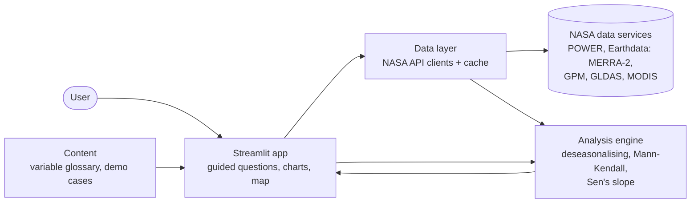

<div align="center">

# TrendScope

**Find out what is changing on Earth, where, by how much, and whether it is real.**

A web tool for exploring trends in NASA Earth science data, built for the
[2026 NASA Space Apps Challenge](https://www.spaceappschallenge.org/2026/).

[](https://www.spaceappschallenge.org/2026/challenges/earth-system-trend-detective/)
[](https://www.spaceappschallenge.org/2026/challenges/earth-system-trend-detective/)
[](https://github.com/abuhuraira99/trendscope-nasa-space-apps-2026/actions/workflows/ci.yml)
[](https://www.python.org/)
[](https://streamlit.io/)
[](LICENSE)

</div>

> [!NOTE]
> **Project status:** the hackathon build runs from **14 to 15 November 2026**. Space Apps rules do not allow
> challenge work before the event starts, so until then this repository holds only the project structure,
> team workflow and tooling. The live demo link and screenshots will be added here at submission.

## The problem

Satellites and global models produce thousands of Earth science variables. A single variable can rise in
one region and fall in another, even when one process drives both. Students and curious members of the
public have no simple way to pick a variable, pull the data for the place they care about, and check
whether the change they see is a real trend or just noise.

## What TrendScope does

TrendScope turns that workflow into a few guided steps:

1. **Ask.** The user answers short questions about what they want to investigate (heat, rainfall, drought,
   vegetation, air quality) and where.
2. **Pick.** TrendScope suggests matching NASA variables and explains each one in plain language.
3. **Fetch.** It retrieves the time series for the chosen region from NASA data services.
4. **See.** An interactive chart shows the series with its trend line, and a map shows where the trend
   is strongest.
5. **Test.** It reports the rate of change per decade, a Mann-Kendall significance test, and a verdict a
   non-specialist can read, for example: *"Temperature rose 0.4 °C per decade. This trend is significant
   (p = 0.003)."*

Built-in demo investigations show the full flow in one click.

## Architecture



Module boundaries and ownership are described in [docs/architecture.md](docs/architecture.md).
Data sources are confirmed against the official challenge resources in
[docs/data-sources.md](docs/data-sources.md).

## Tech stack

| Layer | Tools |
|---|---|
| Web app | Streamlit, Plotly, Folium |
| Data access | NASA POWER API, NASA Earthdata (`earthaccess`, `xarray`), Parquet cache |
| Statistics | `pymannkendall` (Mann-Kendall, Sen's slope), `statsmodels`, NumPy, pandas |
| Quality | Ruff (lint and format), pytest, GitHub Actions CI |
| Hosting | Streamlit Community Cloud |

## Getting started

Requires Python 3.12 or newer.

```bash
git clone https://github.com/abuhuraira99/trendscope-nasa-space-apps-2026.git
cd trendscope-nasa-space-apps-2026

python -m venv .venv
# Windows
.venv\Scripts\activate
# macOS / Linux
source .venv/bin/activate

pip install -r requirements.txt -r requirements-dev.txt
pip install -e .
```

Some NASA datasets need a free [Earthdata login](https://urs.earthdata.nasa.gov/users/new). Copy
`.env.example` to `.env` and add your credentials there. `.env` is git-ignored.

Run the checks:

```bash
ruff check .
pytest
```

Instructions for launching the app will be added when the app exists (14 November 2026).

## Project structure

```text
.
├── app/                    Streamlit user interface
├── content/                Variable glossary and demo investigation text
├── src/trendscope/
│   ├── data/               NASA data clients and caching
│   └── analysis/           Trend statistics
├── tests/                  Automated tests
├── docs/                   Architecture, data sources, team and workflow docs
├── assets/                 Logo, screenshots, media used in docs
└── .github/                CI, issue and pull request templates, code owners
```

## Team

TrendScope is built by a five-person team at the Multan local event of NASA Space Apps 2026.

| Member | Role |
|---|---|
| Abu Huraira ([@abuhuraira99](https://github.com/abuhuraira99)) | Team lead, analysis engine, integration |
| Hafiz Muhammad Haris | Repository, documentation, CI and deployment |
| Muhammad Zawar Khan | Data engineering: NASA data clients |
| Sania Shafiq | UI/UX research, design spec, variable glossary |
| Muhammad Mohsin | Media, communications and demo video |

See [docs/team.md](docs/team.md) for who owns which part of the code.

## Contributing

Work happens on feature branches and reaches `main` only through reviewed pull requests. Read
[CONTRIBUTING.md](CONTRIBUTING.md) before opening one.

## Acknowledgements

This project uses open data from NASA. TrendScope is a hackathon project and is not endorsed by NASA.
The challenge statement is
[Be An Earth System Trend Detective!](https://www.spaceappschallenge.org/2026/challenges/earth-system-trend-detective/)

## License

[MIT](LICENSE) © 2026 Abu Huraira and the TrendScope contributors.
