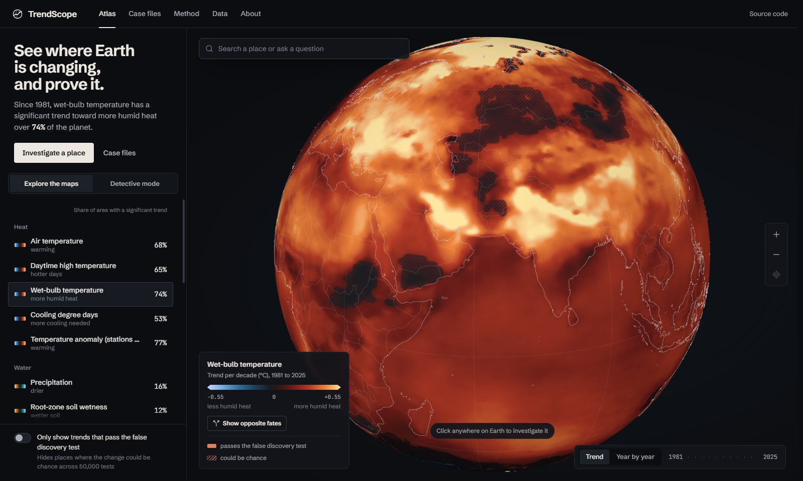
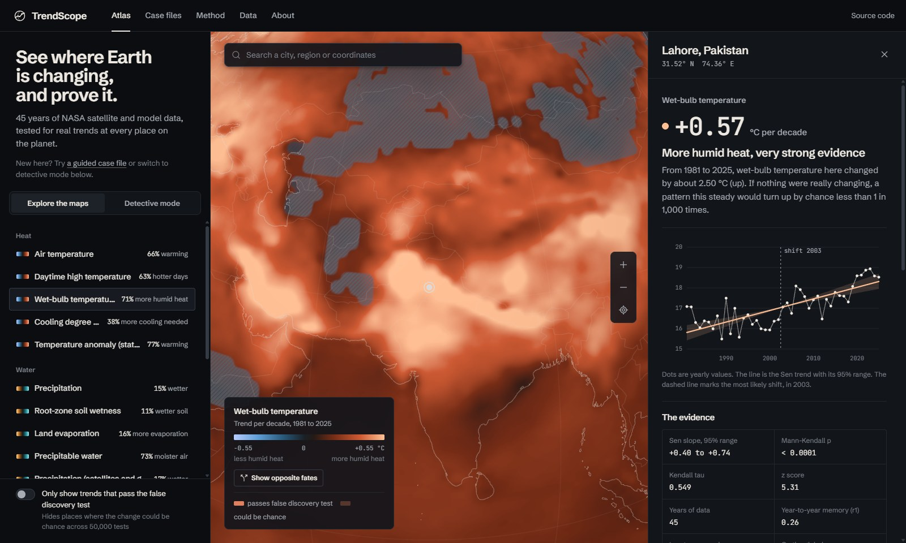
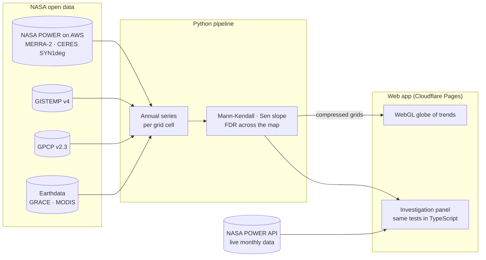

<div align="center">

# TrendScope

**See where Earth is changing, and prove it.**

A global atlas of statistically tested trends in NASA Earth data, built for the
[2026 NASA Space Apps Challenge](https://www.spaceappschallenge.org/2026/challenges/earth-system-trend-detective/).

**[Open the live app → trendscope-earth.pages.dev](https://trendscope-earth.pages.dev)** · [Watch the 30-second demo](https://trendscope-earth.pages.dev/demo)

[](https://github.com/abuhuraira99/trendscope-nasa-space-apps-2026/actions/workflows/ci.yml)
[](https://www.spaceappschallenge.org/2026/challenges/earth-system-trend-detective/)
[](https://trendscope-earth.pages.dev/data)
[](LICENSE)

</div>



## The problem

The challenge asks for a tool that can pick Earth science variables, show how they change, and say
what is changing, where, by how much, and whether the change is what scientists call significant.

The data exists, but answering those questions takes a scientist. Each NASA product has its own
portal, grid and format, and a time series alone does not tell you whether a change is real. Year
to year noise, seasonal cycles and the sheer number of places you could test all make chance look
like a trend.

## What TrendScope does

| The challenge asks to | TrendScope |
|---|---|
| Select variables measured by missions or produced by models | 19 NASA variables in five groups: heat, water, ice, air and plants. Each has a plain-language definition and an expert note |
| Acquire them for a region | Every 1° cell on Earth is preprocessed, and any point can be pulled live from NASA POWER in the browser |
| Visualize the time series | An interactive globe of trends, a year-by-year time-lapse, and a chart for every place with its trend line and 95% range |
| Measure the rate of change | Sen slope per decade with a Gilbert confidence interval, plus a least-squares fit |
| Test significance | Mann-Kendall test with an autocorrelation correction, Benjamini-Hochberg false discovery control across each map, a seasonal Mann-Kendall test, Pettitt change points |
| Help users become detectives | A guided detective mode, six case files, an "opposite fates" finder, and a method page with an interactive shuffle test that makes the p-value visible |



### Click any place on Earth

The investigation panel runs the whole analysis in your browser:

- a verdict in plain words: how much the variable changed and how unlikely that is by chance
- the yearly series with the Sen trend line, its 95% range and the most likely change point
- the evidence table: Sen slope, Mann-Kendall p, Kendall tau, z, lag-1 autocorrelation, least squares
- the detection time: how many years of record a trend of this size needs before it is clear
  (Weatherhead et al. 1998), so a "no trend yet" answer still says something
- a seasonal fingerprint from live NASA POWER monthly data at that exact point
- a second opinion from an independent NASA record (MERRA-2 against GISTEMP stations, or against
  GPCP satellites and gauges)
- a scan of every other variable at that place, ranked by evidence
- CSV download and a shareable link

### Six case files

Guided investigations, each grounded in peer-reviewed research and computed live from the data:
humid heat in Lahore, Arctic amplification, the ozone hole and why the time window matters, the
Sahel and south-west Australia's opposite rainfall fates, dimming and brightening in Germany and
India, and Chile's megadrought.

## How it works



1. `pipeline/` downloads NASA POWER's analysis-ready Zarr archive from AWS Open Data, GISTEMP,
   GPCP and Earthdata products. It builds annual values for every grid cell, from 1981 to the last
   complete year.
2. `src/trendscope/analysis/grid_stats.py` runs the trend tests on all cells at once (about 52,000
   cells by 45 years in seconds) and controls the false discovery rate across each map
   (Wilks 2016).
3. The web app (`web/`) shows the maps on a custom WebGL globe and repeats the same tests in
   TypeScript, so the map and the verdict for a clicked place always agree.

### Statistics you can trust

- The TypeScript library is tested against `pymannkendall` reference values: 487 tests, with p-values
  matching to better than 1e-6.
- The autocorrelation correction is conservative. It applies only when the lag-1 autocorrelation is
  positive and significant, and it never shrinks the variance, because the common shortcut turns
  noise into false trends.
- Maps hatch every place whose trend does not survive the false discovery test, so a reader sees
  real change and possible chance side by side.

The [method page](https://trendscope-earth.pages.dev/method) explains every test twice, in plain
language and with formulas, with the papers behind them.

## NASA data

| Variable group | Source | Years |
|---|---|---|
| Air and daytime temperature, wet-bulb temperature, cooling degree days, precipitation, soil wetness, evaporation, water vapour, snow, sea ice, ozone, wind | MERRA-2 via [NASA POWER](https://power.larc.nasa.gov) | 1981 to 2025 |
| Aerosols, clouds, surface sunlight | CERES SYN1deg via NASA POWER | 2001 to 2025 |
| Surface temperature (observed) | [NASA GISS GISTEMP v4](https://data.giss.nasa.gov/gistemp/) | 1981 to 2025 |
| Precipitation (observed) | [GPCP v2.3](https://psl.noaa.gov/data/gridded/data.gpcp.html) | 1981 to 2025 |
| Water stored on land, vegetation greenness | GRACE/GRACE-FO (NASA JPL) and MODIS (NASA LP DAAC) via [Earthdata](https://www.earthdata.nasa.gov) | see the [data page](https://trendscope-earth.pages.dev/data) |

Full citations for every dataset and method are on the
[data page](https://trendscope-earth.pages.dev/data).

## Run it locally

```bash
git clone https://github.com/abuhuraira99/trendscope-nasa-space-apps-2026.git
cd trendscope-nasa-space-apps-2026/web
npm ci
npm run dev        # http://localhost:5173
npx vitest run     # statistics tests
```

The processed data ships in `web/public/data/`, so the app runs without downloading anything. To
rebuild the data, see [pipeline/README.md](pipeline/README.md).

## Project structure

```text
.
├── web/                     The app: React, TypeScript, three.js globe, statistics library
│   ├── src/lib/stats/       Mann-Kendall, Sen, seasonal, Pettitt, detection time, FDR (+ tests)
│   ├── src/content/         Variable definitions, case files, method text, citations
│   └── public/data/         Precomputed global trend grids
├── pipeline/                NASA data download and grid building
├── src/trendscope/analysis/ Vectorized trend statistics in Python (+ tests)
├── src/trendscope/data/     NASA POWER client, regions and cache for scripts (+ tests)
├── video/                   The 30-second demo video, rendered in GitHub Actions
└── docs/                    Build specification, architecture and team docs
```

## Team TrendScope

Multan local event, Pakistan.

| Member | |
|---|---|
| Abu Huraira ([@abuhuraira99](https://github.com/abuhuraira99)) | Team lead |
| Hafiz Muhammad Haris | |
| Muhammad Zawar Khan | |
| Sania Shafiq | |
| Muhammad Mohsin | |

Some components were built with help from an AI coding agent. The team chose the methods and data
and checked the results against published reference implementations and NASA records.

## Acknowledgements

The data was obtained from National Aeronautics and Space Administration (NASA) Langley Research
Center's Prediction Of Worldwide Energy Resources (POWER) project funded through the NASA Earth
Science Division. GISTEMP is produced by NASA GISS, GPCP by NASA GSFC and NOAA, GRACE by NASA JPL,
and MODIS by NASA LP DAAC. TrendScope is a hackathon project and is not endorsed by NASA.

## License

[MIT](LICENSE) © 2026 Abu Huraira and the TrendScope contributors.
