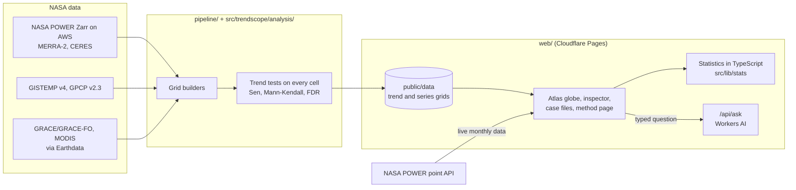

# Architecture

TrendScope has two halves. A Python pipeline turns NASA data into small precomputed trend grids, and
a static web app shows those grids on a globe and repeats the statistics in the browser for any place
a user clicks. There is no server to keep running and no database.

## Parts

| Folder | What it does |
|---|---|
| `pipeline/` | Downloads NASA data and builds one annual series per 1 degree cell for each of the 19 variables. See [pipeline/README.md](../pipeline/README.md) |
| `src/trendscope/analysis/` | Vectorised trend statistics in Python (`grid_stats.py`): Sen slope, Mann-Kendall with the Yue and Wang correction, Benjamini-Hochberg false discovery rate. The grid builders use it |
| `src/trendscope/data/` | A Python client for the NASA POWER monthly API with named regions, a variable catalogue and a local Parquet cache, for scripts and notebooks |
| `web/public/data/` | The pipeline output that ships with the app: `vars.json`, gzipped trend and series grids, and the data for the six case files |
| `web/src/` | The React and TypeScript app: a custom three.js globe, the inspector, detective mode, case files and the method page |
| `web/src/lib/stats/` | The same tests in TypeScript, checked against pymannkendall reference values by 487 automated tests |
| `web/functions/api/ask.ts` | A Cloudflare Pages Function that reads a typed question and returns only a place and a variable. All numbers come from the data |
| `video/` | The 30-second demo video, recorded from the live site and rendered with Remotion in GitHub Actions |

## Data flow

1. The pipeline runs offline and writes the grids to `web/public/data/`.
2. The atlas loads the trend grid for the chosen variable and colours the globe. Cells that fail the
   false discovery test are hatched.
3. When a user clicks a place, the app takes that cell's annual series from the series grid and runs
   the full analysis in the browser, so the map and the verdict always agree.
4. For the seasonal fingerprint the app asks the NASA POWER point API for live monthly data at the
   exact point. If POWER is slow, everything else still works from the shipped grids.
5. A typed question goes to `/api/ask`. If the model is unavailable, a keyword reader in the browser
   answers instead.

## Hosting

| What | Where |
|---|---|
| App | Cloudflare Pages, project `trendscope-earth`. Every push to `main` builds `web/` and deploys it to https://trendscope-earth.pages.dev |
| Question reader | Cloudflare Workers AI through the `AI` binding in `web/wrangler.toml` |
| Checks | GitHub Actions: `lint-and-test` (Ruff and pytest) and `web` (type check, tests, build) |
| Demo video | GitHub Actions on the `video` branch |

Earthdata credentials are needed only to rebuild the GRACE and MODIS grids. They live in a local
`.env` file that is never committed.
