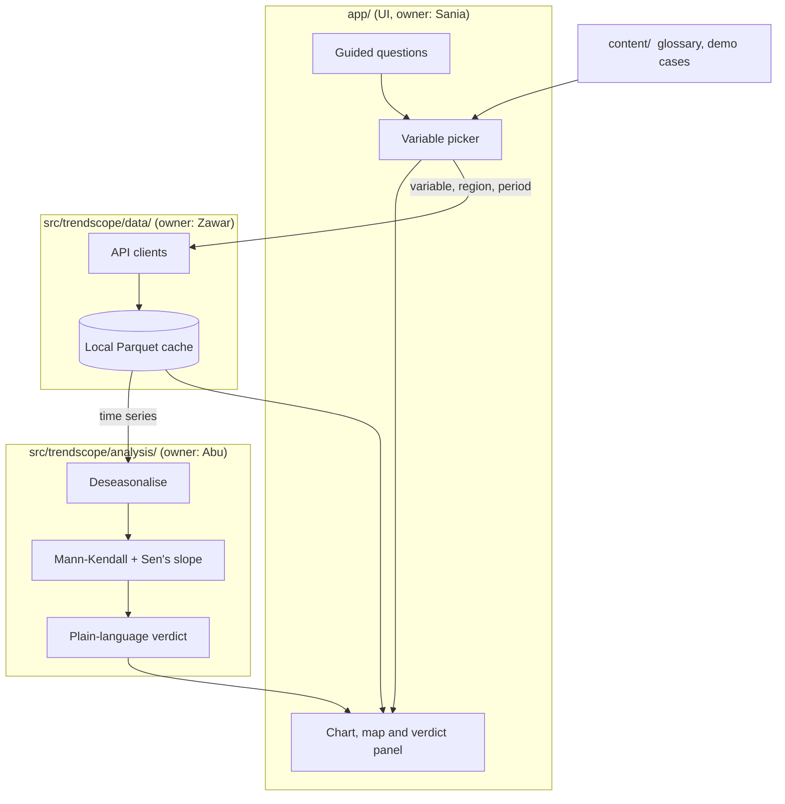

# Architecture

TrendScope is a Python application with three internal layers and one content folder. Each layer has a
single owner, so team members can work in parallel without editing the same files.

## Layers

| Layer | Responsibility | Must not |
|---|---|---|
| `src/trendscope/data` | Download a variable for a region and period from NASA services, normalise it to one tidy table, cache it | Import Streamlit or do statistics |
| `src/trendscope/analysis` | Take a time series and return the trend size, significance and a readable verdict | Make network calls or import Streamlit |
| `app/` | Collect user choices, call data and analysis, draw results | Contain statistics or API code |
| `content/` | Variable definitions and demo investigation text | Contain code |

Keeping Streamlit out of `data` and `analysis` means both can be tested with plain pytest and reused
outside the web app.

## Interfaces

The exact function signatures between layers are agreed at the team kickoff on 14 November 2026 and
recorded here. Each layer exposes a small public API through its `__init__.py`; the other layers import
only from there.

## Data flow

1. The user chooses a theme, a region and a period in the UI.
2. The UI asks the data layer for the matching series. The data layer returns cached data when it has it.
3. The UI passes the series to the analysis layer and receives a result object.
4. The UI draws the chart, the map and the verdict.

## Running and hosting

| Where | How |
|---|---|
| Development | Each developer runs `streamlit run app/streamlit_app.py` locally (`localhost:8501`) |
| Public app | Streamlit Community Cloud (free). It deploys straight from `main` on GitHub and serves a `*.streamlit.app` link; every merge to `main` redeploys |

TrendScope needs no database and no paid hosting:

- Data is fetched from NASA services on request and cached in memory with `st.cache_data`.
- Data for the built-in demos ships in the repository as small Parquet files under `data/demo/`, so
  the demos work even when a NASA service is slow.
- Earthdata credentials are stored as Streamlit secrets, never in the repository.

Free Community Cloud apps go to sleep after a period without visitors and take a short time to wake
on the next visit.
